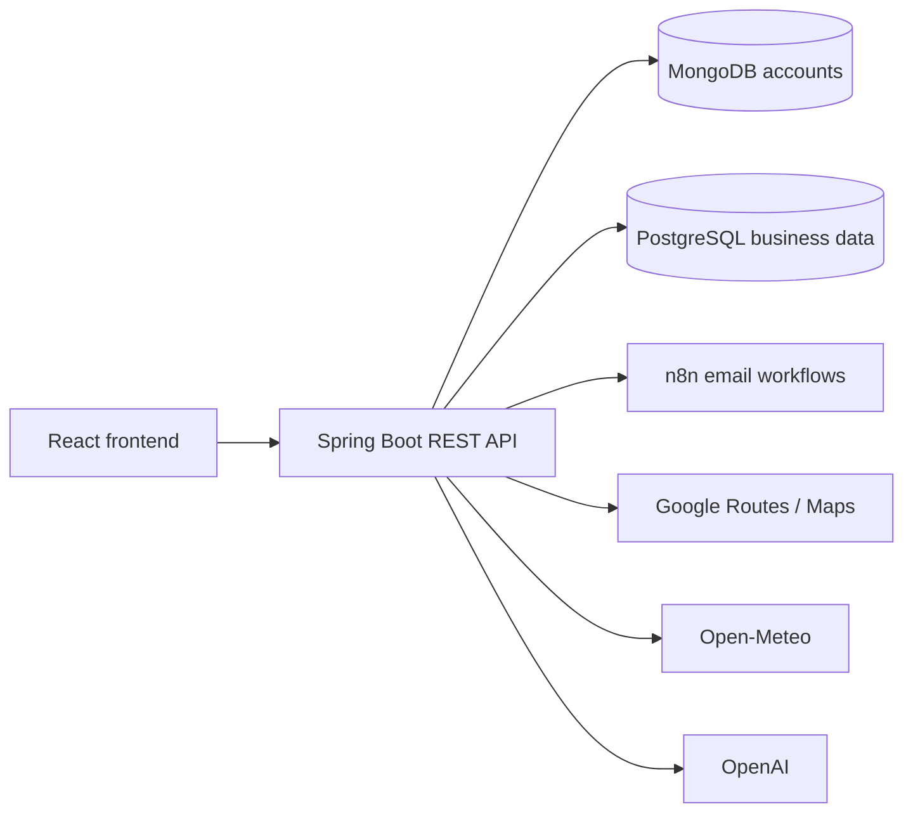

# BookIT - Book your seat

BookIT is a web application for hybrid-office teams, developed during ITSS Summer School 2026. It brings desk and room reservations, colleague invitations, notifications, office-presence analytics, and commuting guidance into one interface. Employees can plan their office visits and manage reservations, while HR and management teams can review workspace usage reports.

## Features

- **User accounts:** registration, login, password recovery, and profile updates.
- **Reservations:** seat or room selection, time slot selection, availability checks, and recurring bookings.
- **Interactive floor plans:** select seats across the shared ground floor, T1 floors 1 and 2, and T2 floors 1 and 2. The map distinguishes available, occupied, pending, selected, unavailable, and whole-room-only positions.
- **Personal booking history:** review upcoming, past, and cancelled reservations, and modify or cancel eligible bookings.
- **Invitations:** invite colleagues to the office and accept or decline invitations.
- **Notifications:** reservation and invitation updates, with an unread notification counter.
- **Dashboard:** office activity, preferred zones, weather, and traffic.
- **Shared navigation:** sidebar, page search, notification bell, and an account menu for profile access and logout.
- **HR and management:** reports, attendance history derived from reservations, and employee preferences. The HR API is available to users with the `HR`, `MANAGER`, or `CEO` role.
- **Travel Assistant:** commuting recommendations based on routes and weather forecasts, with a link to Google Maps.
- **n8n automation:** reservation verification, approvals, invitations, password recovery, and reminders, depending on the configured workflows.

## Tech Stack

| Component | Technologies |
| --- | --- |
| Frontend | React 19, TypeScript, Vite, React Router |
| UI | Tailwind CSS, Material UI, Lucide React |
| Backend | Java 21, Spring Boot, Spring Security, Spring Data JPA |
| Accounts and authentication | MongoDB, session-based authentication |
| Operational data | PostgreSQL: synchronized users, workspaces, reservations, invitations, and notifications |
| Integrations | Google Maps Routes API, Open-Meteo, OpenAI API, SMTP, n8n |

## Architecture

The React frontend handles routing, user interaction, client-side validation, and API requests. The Spring Boot backend applies business rules and uses controllers, services, and repositories to separate HTTP handling, application logic, and persistence.



MongoDB stores authentication identities and account state. PostgreSQL stores the business model: users, departments, office spaces, seats, reservations, invitations, notifications, and audit records. The PostgreSQL user is linked to the MongoDB identity through `users.mongo_user_id`.

The team environment described in the technical documentation uses PostgreSQL hosted on Supabase. Local development can use a local PostgreSQL instance or a configured remote database. Supabase is used as a PostgreSQL host; authentication is handled by the Spring Boot and MongoDB implementation.

External integrations run through the backend, keeping third-party credentials out of the browser. Dashboard cards compose data from separate booking, weather, and traffic endpoints.

## Booking and Invitation Flows

1. Sign in and open **Book Now**.
2. Choose the booking type, initial date, and time interval. For a recurring booking, select the weekly repetitions.
3. Browse the floor plans and select an available seat or a supported whole-room option.
4. Submit the selection. The backend checks availability and creates the reservation, with verification or approval handled by the applicable workflow.
5. Review the booking in **Reservation History** and follow updates through **Notifications**.

Recurring requests create the initial booking plus the requested weekly repetitions: `recurrence = 3` creates four occurrences. The backend checks every occurrence inside a transaction, so a conflicting occurrence rejects the series. Overlap checks allow adjacent intervals when one booking starts exactly as another ends.

Colleague invitations can be accepted or declined from notifications. Acceptance confirms an existing temporary reservation or creates a reservation after rechecking seat availability. Declining releases any temporary booking associated with the invitation. The invitation records its response time and resulting reservation when applicable.

The Travel Assistant supports travel-mode selection and browser location permission. It combines route and weather information into a recommendation and provides a Google Maps navigation link.

## Project Structure

```text
src/
  components/          Shared components
  hooks/               React hooks
  pages/               Application pages
  assets/              Images, logos, and floor plans
backend/
  src/main/java/       Controllers, services, models, and repositories
  src/main/resources/  SQL schema and example configuration
  src/test/java/       Backend tests
public/                Static frontend files
```

Run the backend for the current application from `backend/`. The repository also contains an older backend version in `src/main/java/`, with a separate `pom.xml` at the repository root. The commands below use the project in `backend/`.

## Prerequisites

- Node.js and npm, using a version compatible with the Vite dependency in `package.json`.
- JDK 21 with `JAVA_HOME` configured.
- PostgreSQL and access to a local MongoDB instance or MongoDB Atlas.
- The `psql` client for the setup commands below, or a SQL client such as pgAdmin.
- Internet access to download dependencies and use external integrations.

Maven Wrapper is included, so a separate Maven installation is not required.

## Local Setup

The following commands use PowerShell and start from the repository root.

### 1. Install frontend dependencies

```powershell
npm ci
```

### 2. Set up PostgreSQL

Create the database and apply the included schema:

```powershell
psql -U postgres -c "CREATE DATABASE bookit;"
psql -U postgres -d bookit -v ON_ERROR_STOP=1 -f backend/src/main/resources/schema.sql
```

If the database already exists, run only the schema command. Adjust the username, host, and port for your PostgreSQL instance.

The example configuration uses `spring.jpa.hibernate.ddl-auto=validate` and `spring.sql.init.mode=never`, so the schema must be prepared before starting the backend. A backend seeder initializes office spaces and seats.

### 3. Configure the backend

Create the local configuration file only if it does not already exist:

```powershell
if (-not (Test-Path backend/src/main/resources/application.properties)) {
    Copy-Item backend/src/main/resources/application.properties.example.properties backend/src/main/resources/application.properties
}
```

Set environment variables in the terminal where you will start the backend. Replace the example values with your own settings:

```powershell
$env:MONGODB_URI = 'mongodb://localhost:27017/bookyourseat'
$env:POSTGRES_URL = 'jdbc:postgresql://localhost:5432/bookit'
$env:POSTGRES_USERNAME = 'postgres'
$env:POSTGRES_PASSWORD = '<POSTGRES_PASSWORD>'
```

For MongoDB Atlas, use the connection URI for your own instance. The local properties file can reference environment variables using expressions such as `${POSTGRES_PASSWORD:}`.

`backend/.env.example` documents some of the variables, but the application does not automatically load a `.env` file. Set variables in the terminal or configure them in your IDE's run configuration.

### 4. Start the backend

In the same terminal where you set the environment variables:

```powershell
cd backend
.\mvnw.cmd spring-boot:run
```

The API runs at `http://localhost:8080` by default.

### 5. Start the frontend

Open a second terminal at the repository root:

```powershell
npm run dev -- --port 5173 --strictPort
```

Open `http://localhost:5173` in your browser. The frontend currently calls the API at `http://localhost:8080`, and the backend CORS configuration allows `http://localhost:5173`.

## External Integrations

Set these variables in the backend environment to enable the corresponding features:

| Variable | Purpose |
| --- | --- |
| `GOOGLE_MAPS_API_KEY` | Route calculation through Google Maps Routes API |
| `OPENAI_API_KEY` | Travel Assistant recommendations |
| `MAIL_USERNAME`, `MAIL_PASSWORD` | SMTP authentication |
| `MAIL_HOST`, `MAIL_PORT` | SMTP server; defaults to `smtp.gmail.com` and `587` |
| `N8N_WEBHOOK_URL` | General webhook and fallback for reservation verification |
| `N8N_RESERVATION_VERIFICATION_WEBHOOK_URL` | Reservation verification |
| `N8N_MANAGER_APPROVAL_WEBHOOK_URL` | Management approval workflow |
| `N8N_REMINDER_WEBHOOK_URL` | Reservation reminders |
| `N8N_INVITATION_WEBHOOK_URL` | Sending invitations |
| `N8N_INVITATION_RESPONSE_WEBHOOK_URL` | Invitation responses |
| `N8N_FORGOT_PASSWORD_WEBHOOK_URL` | Password recovery |

The project calls Open-Meteo without a configured API key. Set the office coordinates through `office.latitude` and `office.longitude` in your local properties file. Gmail SMTP may require an app password.

Active keys and webhooks are needed for full integration with external services. Without `OPENAI_API_KEY`, the assistant displays a configuration message. The dashboard can display fallback data if weather or traffic requests fail; walking, cycling, and public transport estimates in its table are calculated locally.

## API Overview

These representative routes are taken from the current backend implementation. Most application routes require an authenticated session; HR routes additionally require an authorized role.

| Area | Representative endpoints |
| --- | --- |
| Authentication | `POST /register`, `POST /login`, `POST /logout`, `POST /forgot-password`, `POST /reset-password` |
| Account | `GET /me`, `PUT /me/phone`, `PUT /me/password`, `GET /me/reservations` |
| Availability | `GET /api/availability/rooms`, `GET /api/availability/seats` |
| Reservations | `POST /reservations`, `PUT /reservations/{id}`, `GET /reservations/history`, `PUT /reservations/cancel/{id}` |
| Invitations | `POST /api/invitations`, `GET /api/invitations/colleagues`, `GET /api/invitations/pending`, `POST /api/invitations/{id}/accept`, `POST /api/invitations/{id}/decline` |
| Notifications | `GET /api/notifications/me`, `GET /api/notifications/me/unread-count`, `PUT /api/notifications/{notificationId}/read` |
| HR | `GET /hr/reports`, `GET /hr/users`, `GET /hr/attendance-history`, `GET /hr/preferences` |
| Travel | `GET /weather-test`, `GET /traffic-routes`, `GET /recommendation`, `GET /route-url` |

## Checks and Build

From the repository root:

```powershell
npm run lint
npm run build
npm run preview
```

From `backend/`:

```powershell
.\mvnw.cmd test
```

Tests cover availability and reservations, along with Spring application context loading. The context test requires the configuration and databases to be available.

The technical documentation also describes manual verification through browser workflows, Postman requests, MongoDB inspection, Supabase/DBeaver queries, and n8n execution history. Suggested regression scenarios include overlap boundaries, recurring-booking conflicts, invitation responses, role-based access, and responsive layouts. Playwright coverage is a documented recommendation, rather than an included test suite in this repository.

## Private Configuration

Keep passwords, API keys, and private webhook URLs in your local environment. The `.env` files and `backend/src/main/resources/application.properties` are ignored by Git. Example files should contain only environment variable references or demonstration values.

BookIT is an educational project. When deploying to another environment, configure the API URLs, CORS origins, databases, and external services for that environment.

## Team

Developed by Team 1 during ITSS Summer School 2026:

- Antonia Dutu
- Eduard Tomulescu
- Alex Neacsu
